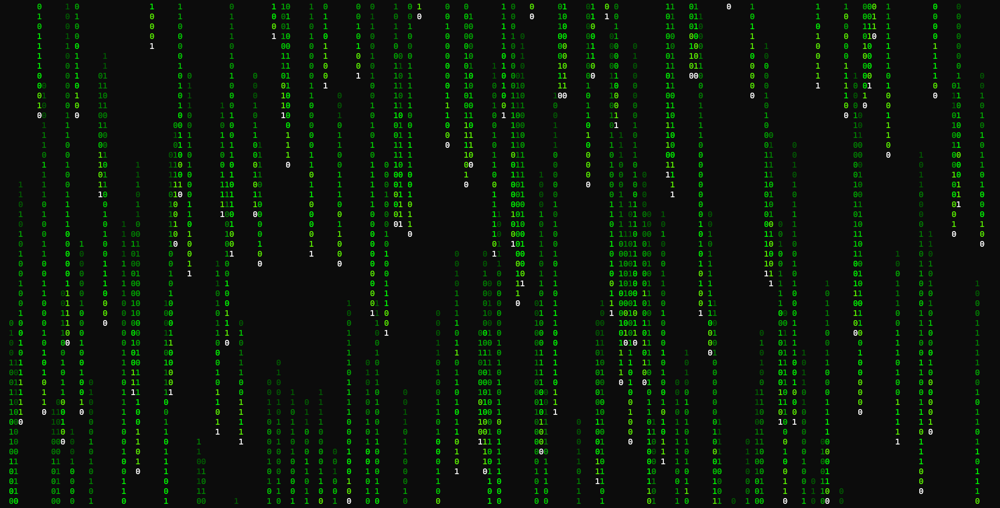

# Rain Drops 🟢

A Windows screensaver featuring cascading green binary rain,
built with Python and Tkinter.


Created by CorruptedConsciousness.

## Features

- Full-screen cascading binary animation
- Bright white leading digits
- Fading green trails
- Randomized falling speeds and trail lengths
- Automatically launches after Windows inactivity
- Exits when the mouse moves or a key is pressed
- Standalone Windows screensaver — no Python installation required

## Installation

1. Download `rain_drops.scr` from the latest GitHub Release.
2. Right-click the downloaded file and select **Install**.
3. Select Rain Drops in Windows Screen Saver Settings.
4. Choose your preferred inactivity timeout.
5. Click Apply.

Windows may display a security warning for unsigned
software. Only run files from sources you trust.

## Running from Source

Requires Python with Tkinter installed.

```powershell
python rain_drops.py
```

## Building

Install PyInstaller:

```powershell
python -m pip install pyinstaller
```

Build the executable:

```powershell
python -m PyInstaller --onefile --windowed --name rain_drops rain_drops.py
```

Create the screensaver:

```powershell
Copy-Item .\dist\rain_drops.exe .\dist\rain_drops.scr
```

## Known Limitations

The Windows Screen Saver Settings thumbnail preview
is not currently supported.

## License

MIT License. See [LICENSE](LICENSE).
